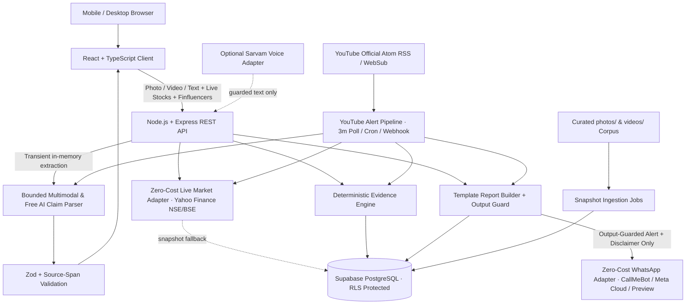

# Tip Autopsy — Technical Architecture

**Document status:** Approved V1 baseline + Phase 4 (V2) Zero-Cost Real-Time & Finfluencer WhatsApp Alert Architecture  
**Blueprint version:** 2.0  
**Architecture principle:** Deterministic evidence engine, bounded free-tier AI parsing, zero-cost live feeds with snapshot fallback, Output-Guarded WhatsApp alerts, and narrow opt-in subscription persistence only.

---

## 1. Architecture Summary

Tip Autopsy is a TypeScript React web client backed by a **Node.js + Express (TypeScript)** API service (MERN-based architecture) and **Supabase (PostgreSQL)** for relational snapshot persistence. The client is mobile-first and communicates with the backend through versioned JSON and multipart REST endpoints. Historical market, surveillance, SEBI-register, and curated tip/media data are loaded as dated snapshots in Supabase PostgreSQL. The backend computes the five market/lateness checks, benchmark-adjusted creator statistics, and Information Verdict (facts-card) content deterministically.

When a user enters the site, they can submit **any photo, video, or pasted text**, paired with the **influencer name** and **stock/instrument name**. A bounded AI / multimodal extraction adapter (OCR/vision for photos, audio transcription/frame extraction for short videos, and Hinglish text parsing) is isolated behind a parser adapter and may only extract source text and propose a validated Claim Ledger with source spans. It cannot provide market data, decide risk statuses, calculate track records, or write facts-card narrative. If media or text parsing is unavailable, the user-supplied influencer + stock lookup path remains fully usable.

### 1.1 Selected stack

The source specification permits React + Tailwind, FastAPI or Express, PostgreSQL, a bounded LLM, Sarvam voice, and scheduled snapshot ingestion. This blueprint selects a **MERN-based TypeScript stack backed by Supabase PostgreSQL** for unified frontend/backend language ergonomics, rapid iteration, and managed PostgreSQL tooling:

| Layer | Selected technology | Reason for selection |
|---|---|---|
| Frontend | React, TypeScript, Vite | Fast feedback loop, component ecosystem, static deployment, and type-safe API integration. |
| Styling and UI | Tailwind CSS with accessible Radix/shadcn-style primitives + Phosphor Icons (`@phosphor-icons/react`) | Rapid, consistent responsive UI matching `DESIGN.md` v2.0 without Lucide or emoji icons. |
| Client routing | React Router | Clear step-based user flow and shareable routes without server rendering requirements. |
| Server-state | TanStack Query | Request caching, retries, loading/error states, and invalidation for read-heavy evidence views. |
| Local state | React Context + `useReducer` | Keeps transient tip input, current analysis, selected chart marker, and Pause & Plan responses in memory only. |
| Charting | Recharts with a custom marker interaction layer | Suitable for interactive price/volume charts and accessible tooltip/detail behavior. |
| Backend | Node.js 22+, Express, TypeScript (`tsx` / `tsc`) | Unified TypeScript across the MERN-based stack, clean middleware pipeline, and fast REST development. |
| Validation | Zod | Strict runtime request/response schemas, environment validation, and parser-output validation. |
| Multipart handling | Multer (`memoryStorage()`) | Enforces transient in-memory photo/video buffers with strict MIME/magic-byte and size caps; never writes user uploads to disk. |
| Database | Supabase (Managed PostgreSQL) | Relational joins across creators, tips, stocks, dates, and immutable snapshots; reliable constraints, indexes, RLS, and MCP-assisted migrations. |
| DB client & migrations | `pg` / `@supabase/supabase-js` (server-side service role) + Supabase SQL migrations (`supabase/migrations/`) | Parameterized SQL queries, versioned declarative/imperative SQL migrations, and Supabase security advisors. |
| Statistical/decimal tools | `decimal.js` + pure TypeScript Beta-Binomial statistics module | Exact financial decimal arithmetic and reproducible Beta distribution quantiles with zero native build dependencies. |
| Backend tests & lint | Vitest, Supertest, ESLint, `tsc --noEmit` | Fast unit and HTTP integration testing of deterministic logic, Output Guard, and API contracts. |
| Frontend tests & lint | Vitest, React Testing Library, Playwright, ESLint | Component, behavior, and complete user-flow coverage. |
| Frontend hosting | Netlify | Straightforward static React deployment and preview deploys. |
| Backend hosting | Render web service | Simple Node.js/Express deployment with environment-managed secrets and logs. |
| Production database | Supabase PostgreSQL | Managed PostgreSQL with branching/staging support, backups, and security advisors. |
| Optional voice | Sarvam Voice API | Matches the product specification's optional Hindi/Kannada/English readout. |
| Real-time Indian market feed (Phase 4) | Yahoo Finance v8 Chart/Quote & Search API (`.NS`, `.BO`, `^NSEI`, `^BSESN`, `^NSEBANK`) + TTL cache | Zero-cost (`$0`, no API key) near-real-time NSE/BSE quotes, ticker search, and daily OHLCV with automatic Supabase snapshot fallback. |
| Real-time YouTube video monitor (Phase 4) | Official YouTube Atom RSS (`youtube.com/feeds/videos.xml`) + optional WebSub push + public caption extractor | Zero-cost (`$0`, unlimited, zero scraping) detection of new finfluencer uploads + caption/metadata extraction. |
| Bounded free-tier AI parser (Phase 4) | Google Gemini AI Studio free tier (`gemini-2.5-flash`) / Groq free tier (`llama-3.3-70b-versatile`) + deterministic Hinglish fallback | Zero-cost structured JSON Claim Ledger extraction strictly validated via Zod and source spans. |
| Automated WhatsApp alerts (Phase 4) | Pluggable `whatsappNotifier.ts` (`callmebot`, official `meta_cloud` free sandbox, `dry_run` preview) | Zero-cost automated delivery of strictly Output-Guarded video evidence summaries + mandatory disclaimer. |

Use a single repository with separate `frontend/`, `backend/`, and `supabase/` workspaces. Do not add MongoDB, Redis, a message broker, microservices, or Kubernetes for Version 1; none is needed for the expected scale or demo workflow.

### 1.2 High-level component view



### 1.3 Request lifecycle

1. The browser submits a photo, video, or pasted tip text alongside the user-entered **influencer name** and **stock/instrument name** (or selects a curated sample from `photos/` or `videos/`).
2. If media is provided, the bounded multimodal adapter validates file type/size/duration, transiently extracts visible text/transcript in memory (deleting any ephemeral buffer immediately after parsing), and proposes a Claim Ledger. The backend validates its schema, normalizes entities, checks source spans against the extracted/pasted text, and marks unsupported, gated (`SL PAID` / `SL. VIP PREMIUM`), or absent fields `Not stated`.
3. The browser requests dated evidence for the resolved stock/instrument and influencer name. The backend loads the relevant snapshot versions and calculates SEBI register matching and every deterministic market check.
4. The report builder assembles the **Information Verdict (Guarded Facts Card)** sentences from approved templates and verified values.
5. The Output Guard validates every system-authored sentence. If unsafe content is found, the report is blocked and a safe fallback is returned.
6. The browser renders the matched stock context, Information Verdict, provenance, status labels, and the mandatory disclaimer. User-submitted photos, videos, text, and Pause & Plan answers remain in active client memory only and are never persisted.

## 2. Repository and Module Boundaries

Recommended repository layout (a target structure for implementation, not files created by this blueprint):

```text
/
├── frontend/
│   ├── src/
│   │   ├── app/              # Router, providers, application shell
│   │   ├── components/       # Reusable UI primitives + verbatim DashBoardBackground.jsx
│   │   ├── features/
│   │   │   ├── input/
│   │   │   ├── claim-ledger/
│   │   │   ├── evidence/
│   │   │   ├── time-machine/
│   │   │   ├── facts-card/
│   │   │   └── pause-plan/
│   │   ├── lib/              # API client, formatters, shared helpers
│   │   └── types/            # API and domain types
│   └── ...
├── backend/
│   ├── src/
│   │   ├── api/              # Express routers, middleware, and request validation
│   │   ├── core/             # Zod env settings, structured logging, error types
│   │   ├── db/               # Supabase / pg client, typed repositories, query helpers
│   │   ├── domain/
│   │   │   ├── claims/       # Claim Ledger Zod schemas and normalization
│   │   │   ├── disclosure/   # Disclosure classifier
│   │   │   ├── hype/         # Phrase detection
│   │   │   ├── sebi/         # Register matching
│   │   │   ├── market-checks/# Five deterministic checks
│   │   │   ├── track-record/ # Benchmark adjustment and Beta-Binomial
│   │   │   └── output-guard/ # Templates, guard, safe fallback
│   │   ├── integrations/     # LLM, multimodal OCR/ASR extraction, and optional Sarvam adapters
│   │   ├── ingestion/        # Snapshot loaders and validation scripts
│   │   ├── app.ts            # Express app factory (testable via Supertest)
│   │   └── server.ts         # HTTP server entry point
│   ├── tests/
│   └── ...
├── supabase/
│   └── migrations/           # Versioned PostgreSQL SQL migrations (applied via Supabase MCP/CLI)
├── photos/                   # Curated Hinglish tip screenshots (<Influencer>__<Stock>__<Registration>.jpeg)
├── videos/                   # Curated Hinglish finfluencer clips (<Influencer>__<Stock>__<Registration>.App.mp4)
├── ui-ux/                    # Approved visual references (hero.jpeg, DashBoard.png, verbatim DashBoardBackground.jsx)
├── docs/                     # Approved methodology and data-source notes
└── TASKS.md / PRD.md / ARCHITECTURE.md / DESIGN.md / AGENTS.md
```

Keep calculations independent from Express route handlers. Route handlers validate requests with Zod and orchestrate domain services; they must not contain threshold logic or statistical formulas.

## 3. Data Architecture

### 3.1 Persistence principles

Persist curated reference data and dated public/synthetic datasets. Do not persist end-user profiles, accounts, portfolios, user-uploaded photos or videos, raw pasted tips, Pause & Plan answers, or user-level analysis history.

User-submitted photos, videos, and pasted text are transient inputs. The intake endpoint may forward transient media/text to a configured server-side OCR/ASR/LLM extraction provider under reviewed data-handling terms, but the application must not write user-uploaded files or raw tip text to PostgreSQL, permanent object/disk storage, analytics events, traces, exception messages, or ordinary logs. Ephemeral media buffers must be discarded immediately when extraction completes or fails. Do not send raw user text or media to third-party analytics.

Publicly sourced creator names/handles and the curated `photos/` and `videos/` demo corpus are dataset content, not end-user profile data; still minimize retained fields and document source/usage rights.

### 3.2 Relational entities

The following tables extend the core entities in the source specification with provenance and operational fields needed for repeatable production behavior. The Nifty 50 benchmark series is modelled explicitly so creator outcomes can be reproduced without treating an index as an ordinary stock.

#### `data_snapshot`

| Field | Type / constraint | Purpose |
|---|---|---|
| `id` | UUID primary key | Identifies one imported dataset snapshot. |
| `dataset_key` | text, indexed | Domain such as `nse_prices`, `bse_prices`, `sebi_register`, `surveillance`, or `market_cap`. |
| `source_name` | text | Human-readable source/provider. |
| `source_url` | text, nullable | Original source location when available. |
| `as_of_date` | date | Date represented by the dataset. |
| `retrieved_at` | timestamptz | Import time. |
| `data_label` | enum: `REAL`, `SYNTHETIC`, `MIXED` | Provenance label. |
| `version` | text | Version of the import or source format. |
| `checksum` | text | Detects accidental replacement or corruption. |
| `row_count` | integer | Imported record count. |
| `validation_status` | enum | `VALID`, `PARTIAL`, or `REJECTED`. |
| `notes` | text, nullable | Limitations, licensing notes, or import warnings. |

#### `influencer`

| Field | Type / constraint | Purpose |
|---|---|---|
| `id` | UUID primary key | Internal creator identifier. |
| `name` | text | Display name from curated tip records. |
| `handle` | text, nullable | Public platform handle when permitted. |
| `normalized_name` | text, indexed | Conservative name matching. |
| `sebi_registration_no` | text, nullable | Optional curated registration reference; not authoritative without snapshot matching. |
| `created_at` | timestamptz | Row creation time. |

#### `sebi_register_entry`

| Field | Type / constraint | Purpose |
|---|---|---|
| `id` | UUID primary key | Register entry identifier. |
| `snapshot_id` | UUID foreign key to `data_snapshot` | Exact register snapshot used. |
| `name` | text | Registered legal/display name from source. |
| `normalized_name` | text, indexed | Matching support. |
| `registration_no` | text, indexed | Register identifier. |
| `category` | text | Source category. |
| `snapshot_date` | date | Dated validity of the imported register. |

Use a uniqueness constraint on (`snapshot_id`, `registration_no`). Never infer registration solely from fuzzy name similarity. Ambiguous matches return `Unclear`.

#### `stock`

| Field | Type / constraint | Purpose |
|---|---|---|
| `ticker` | text primary key | Canonical exchange ticker or curated instrument identifier (e.g., `WIPRO`, `BORORENEW`, `SARVESHWAR`, `NIFTY_25500_CE`, `SENSEX_82900_CE`). |
| `company_name` | text | Company or contract display name. |
| `exchange` | enum: `NSE`, `BSE` | Exchange. |
| `instrument_type` | enum: `EQUITY`, `DERIVATIVE` | Distinguishes cash equities from index/stock option contracts so equity-only checks (`market_cap`, `surveillance`) return `COULD_NOT_VERIFY` cleanly for options when inapplicable. |
| `underlying_ticker` | text, nullable | Optional underlying index/equity key (e.g., `NIFTY_50`, `SENSEX`) for derivative context. |
| `circuit_band` | text, nullable | Most recent imported band; dated surveillance snapshots remain authoritative for historical queries. |
| `created_at` | timestamptz | Row creation time. |

#### `price_history`

| Field | Type / constraint | Purpose |
|---|---|---|
| `id` | UUID primary key | Row identifier. |
| `ticker` | text foreign key to `stock` | Security. |
| `trading_date` | date | Trading session. |
| `close` | numeric(18, 4) | Closing price. |
| `volume` | bigint | Traded volume. |
| `snapshot_id` | UUID foreign key to `data_snapshot` | Exact source snapshot. |

Unique key: (`ticker`, `trading_date`, `snapshot_id`). Index (`ticker`, `trading_date`). Do not overwrite historical rows without retaining snapshot provenance.

#### `stock_info`

| Field | Type / constraint | Purpose |
|---|---|---|
| `id` | UUID primary key | Row identifier. |
| `ticker` | text foreign key to `stock` | Security. |
| `market_cap` | numeric(22, 2), nullable | Dated market capitalization. |
| `size_band` | enum: `LARGE`, `MID`, `SMALL`, `MICRO`, nullable | Versioned classification result. |
| `circuit_band` | text, nullable | Circuit-band value represented by this snapshot. |
| `snapshot_id` | UUID foreign key to `data_snapshot` | Exact source snapshot. |
| `classification_version` | text | Methodology version for size bands. |

Unique key: (`ticker`, `snapshot_id`). Do not classify when market cap, circuit-band evidence, or the applicable band methodology is missing.

#### `benchmark_history`

| Field | Type / constraint | Purpose |
|---|---|---|
| `id` | UUID primary key | Row identifier. |
| `benchmark_key` | text, indexed | Index identifier; Version 1 uses `NIFTY_50` (required for track-record adjustment) and optional overview benchmarks `SENSEX` and `BANKNIFTY`. |
| `trading_date` | date | Trading session. |
| `close` | numeric(18, 4) | Official/verified index close. |
| `snapshot_id` | UUID foreign key to `data_snapshot` | Exact source snapshot. |

Unique key: (`benchmark_key`, `trading_date`, `snapshot_id`). Index (`benchmark_key`, `trading_date`). This dataset is required for benchmark-adjusted creator outcomes.

#### `surveillance_entry`

| Field | Type / constraint | Purpose |
|---|---|---|
| `id` | UUID primary key | Row identifier. |
| `ticker` | text foreign key to `stock` | Security. |
| `list_name` | enum/text | ASM, GSM, or another explicitly named exchange list. |
| `is_active` | boolean | Status represented by this snapshot. |
| `snapshot_id` | UUID foreign key to `data_snapshot` | Exact exchange snapshot. |
| `snapshot_date` | date | Snapshot date. |

#### `tip`

| Field | Type / constraint | Purpose |
|---|---|---|
| `id` | UUID primary key | Tip identifier. |
| `influencer_id` | UUID nullable foreign key to `influencer` | Creator when known. |
| `ticker` | text nullable foreign key to `stock` | Canonical security when resolved. |
| `tip_date` | date | Publication date. |
| `text` | text | Curated source tip text; only permitted public or team-authored corpus rows. |
| `direction` | enum/text nullable | Direction stated in the original tip. |
| `target_price` | numeric nullable | Extracted original claim, not an app recommendation. |
| `deadline` | date nullable | Stated resolution date. |
| `stop_loss` | numeric nullable | Stated original claim. |
| `extracted_claim_json` | JSONB | Curated/validated Claim Ledger. |
| `disclosure_grade` | enum: `CLEAR`, `VAGUE`, `NONE`, `UNKNOWN` | Evidence classification. |
| `source_url` | text nullable | Original source link, after URL validation. |
| `is_synthetic` | boolean | Compatibility flag for record-level labeling. |
| `snapshot_id` | UUID nullable foreign key | Dataset import that introduced the row. |
| `created_at` | timestamptz | Import time. |

Index (`influencer_id`, `ticker`, `tip_date`). For a production schema, `is_synthetic` must always be set explicitly; do not rely on a nullable default.

#### `calibration_case` (recommended for reproducible threshold calibration)

Store public enforcement-case references and the associated security/date window, source link, event classification, and calibration dataset version. Do not store unsupported allegations or label any creator as fraudulent. Keep the calibration set small and disclose its limitations.

#### `ingestion_run`

Store dataset key, start/end times, snapshot identifier, status, imported/rejected counts, validation summary, and a safe error summary. Do not store secrets or raw user text.

#### Phase 4 Extensions: YouTube Monitoring & Opt-In WhatsApp Alert Tables

- **`influencer` (extended columns):** `youtube_channel_id` (text, unique when non-null), `youtube_handle` (text, nullable), `youtube_channel_url` (text, nullable), `avatar_initials` (text, nullable), and `bio_summary` (text, nullable).
- **`youtube_video_analysis`:** Stores each analyzed YouTube upload (`id`, `influencer_id` FK, `video_id` unique, `title`, `video_url`, `thumbnail_url`, `published_at`, `transcript_source` `'CAPTIONS' | 'METADATA_ONLY'`, `detected_ticker`, `claim_ledger_json`, `hype_flags_json`, `disclosure_grade`, `guarded_report_json`, `guard_status` `'PASSED' | 'BLOCKED_FALLBACK'`, `whatsapp_summary_text`, `analyzed_at`).
- **`finfluencer_subscription`:** Narrow opt-in alert persistence (`id`, `influencer_id` FK, `phone_hash` HMAC-SHA256, `phone_masked` e.g. `+91******3210`, `phone_encrypted` AES-256-GCM, `provider` `'callmebot' | 'meta_cloud' | 'dry_run'`, `provider_config_encrypted` AES-256-GCM, `is_active`, `consent_given_at`, `unsubscribe_token` unique, `created_at`). Unique index on (`influencer_id`, `phone_hash`).
- **`whatsapp_delivery_log`:** Idempotent delivery audit log (`id`, `subscription_id` FK, `video_analysis_id` FK, `provider`, `delivery_status` `'SENT' | 'DRY_RUN_PREVIEW' | 'FAILED' | 'BLOCKED_BY_GUARD'`, `message_preview`, `error_code`, `sent_at`). Unique constraint on (`subscription_id`, `video_analysis_id`) guarantees a subscriber never receives duplicate alerts for the same video.

All Phase 4 tables MUST have Supabase Row Level Security (RLS) enabled with explicit `deny_public_access_*` policies (`FOR ALL TO anon, authenticated USING (false) WITH CHECK (false)`). Plaintext phone numbers and CallMeBot API keys must never be logged or returned in API responses.

### 3.3 Database rules, RLS, and indexes

- Use foreign keys and explicit enum/check constraints for statuses and data labels.
- Store all dates as dates when time-of-day is not meaningful; use timezone-aware timestamps for ingestion/audit times.
- Store market prices and market caps as `numeric` decimals, never binary floating-point values in persistence; perform arithmetic in TypeScript with `decimal.js`.
- Index ticker/date history, creator/ticker/tip-date lookups, snapshot date/domain, and SEBI normalized-name/registration lookup.
- Keep imported snapshots immutable. A correction creates a new snapshot/version and preserves prior provenance.
- Enable **Row Level Security (RLS)** on every table in the `public` schema in Supabase PostgreSQL as defense-in-depth, with no permissive `anon`/`authenticated` write policies (and route all client queries exclusively through the Express backend using server-side credentials so Output Guard and deterministic checks cannot be bypassed via direct Data API access).
- Use versioned Supabase SQL migrations (`supabase/migrations/`) for every schema change and run Supabase security/performance advisors (`get_advisors`). Avoid ad hoc production schema changes.
- Never add user accounts, user profiles, portfolios, saved tips, or raw-input history tables in Version 1.

## 4. Deterministic Domain Logic

### 4.1 Common check result contract

Each market check returns:

```json
{
  "check_id": "volume_spike",
  "status": "NEEDS_ATTENTION",
  "measured_value": 6.1,
  "unit": "x_average_volume",
  "as_of_date": "2026-11-19",
  "source_snapshot_id": "0f7e9f6d-2d5a-4f1d-9e3a-5c8b0e7a1101",
  "method_version": "volume-spike-v1",
  "explanation_key": "volume_spike_explanation"
}
```

The date shown in a report must come from the selected source snapshot, not from the browser clock. If any required input, date alignment, or methodology version is missing, return `COULD_NOT_VERIFY` with a reason code. Do not return a guessed numeric value.

### 4.2 Five checks

1. **Liquidity** — Compute daily traded value as `close × volume`, then calculate the average over the configured prior N valid trading sessions. Classify using a versioned threshold table calibrated against historical enforcement cases and a normal-stock set.
2. **Market cap** — Load the market-cap snapshot for the applicable as-of date and map it to Large/Mid/Small/Micro using versioned boundaries. The boundary source and effective date must be documented. If the boundary scheme or cap value is absent, return `COULD_NOT_VERIFY`.
3. **Volume spike** — Compare tip-date volume with average volume over the prior N valid sessions. Retain both ratio and, where calibrated, z-score. Use a versioned threshold table; never hard-code an unexplained cutoff.
4. **Pre-tip run-up** — Calculate the percentage change from the close five valid trading sessions before the tip to the close immediately preceding the tip. Display the exact date range and formula. Missing sessions return `COULD_NOT_VERIFY`.
5. **Surveillance / circuit band** — Look up dated ASM/GSM membership and applicable circuit-band snapshot. Return a clear yes/no status only when the relevant snapshot exists and covers the queried date; otherwise return `COULD_NOT_VERIFY`.

The initial lookback default for N may be 20 valid trading sessions, but it remains configuration and must be validated before release. Calibration tasks must compare precision and recall against a naive baseline (including a small-cap-only heuristic) and report confidence intervals.

### 4.3 Creator track record

For each historical tip that has a valid direction, tip date, stated deadline, and aligned market data:

- Use the first valid market close strictly after the tip publication date as the entry reference; when only a date (not a timestamp) is available, use the next valid trading session close to avoid assuming the tip was available before that day’s close.
- Compute the security return from that entry reference to the stated deadline close. Compute the Nifty 50 return over exactly the same interval.
- Compute directional excess return as:

  `directional_excess_return = direction_sign × (security_return - nifty_50_return)`

  where `direction_sign` is `+1` for a bullish/up claim and `-1` for a bearish/down claim.
- Classify positive directional excess return as a success and negative directional excess return as a failure. Exact ties and observations without valid date alignment are excluded from the binary denominator and reported as unresolved/excluded counts.
- Compute the creator posterior using a versioned Beta prior: `Beta(alpha_prior + successes, beta_prior + failures)`.
- Display the selected credible interval (95% default), resolved sample count, excluded count, benchmark methodology, and as-of date.
- Display `Not enough tips to judge` when fewer than 20 resolved tips are available (provisional MVP policy) or the credible interval does not clear the matched market baseline. The minimum sample count, prior, baseline cohort, and interval level are configuration values documented in the methodology.

Do not display an unadjusted creator leaderboard or imply that past outcomes predict future returns. The 20-tip floor is an initial conservative implementation policy and must be revisited during evaluation; it is not a claim contained in the source specification.

### 4.4 Multimodal Intake, Claim Ledger, and Bounded Language Model

- **Multimodal input validation:** Accept image uploads (`.jpeg`, `.jpg`, `.png`, `.webp`), short video uploads (`.mp4`, `.webm`, `.mov`), or plain Hinglish/English text, alongside user-supplied `influencer_name` and `stock_name`. Enforce server-side MIME/magic-byte verification, max file size limits, and max video duration limits before processing.
- **Transient extraction:** For photos, run bounded OCR/vision text extraction; for videos, extract speech transcript (ASR) and/or keyframe text transiently in memory/ephemeral buffer and discard the media immediately after extraction. Never trust an arbitrary uploaded filename for registration status or stock verification.
- **Curated media corpus convention (`photos/` & `videos/`):** Preloaded demo assets use `<Influencer_Name>__<Stock_Name>__<Registration>` filenames (`Ashish_Kyal__Sensex_82900_CE__Not_Registered.jpeg`, `Chinmay_Dudhane__Nifty_25500_CE__Registered.jpeg`, `Harsh_Bhagat__Nifty_25600_CE__Not_Registered.jpeg`, `Rakesh_Bansal__Borosil_Renewables_Ltd__Registered.App.mp4`, `Rakesh_Bansal__Sarveshwar_Foods__Registered.App.mp4`, `Vivek_Rana__Wipro_Limited__Not_Registered.App.mp4`). During seed ingestion, these map to curated `influencer`, `stock`, `tip`, and dated `sebi_register_entry` records with explicit `Mixed` / `Synthetic` provenance; live user analysis always resolves SEBI registration deterministically against `sebi_register_entry` snapshots.
- **Bounded parser contract:** The LLM adapter receives only the extracted/pasted text required for parsing and a constrained extraction instruction.
- Its only allowed output is a schema-constrained object containing stock/instrument, direction, target price, deadline, stop-loss (marking gated cues like `SL PAID` or `SL. VIP PREMIUM` as `NOT_STATED` / gated), and source-span offsets/quotes.
- Validate JSON with Zod. Reject invalid types, unsupported fields, out-of-range spans, or evidence quotes that do not match the extracted/pasted source text.
- Normalize ticker/instrument candidates against the local stock catalogue (incorporating the user-entered `stock_name` as authoritative fallback/override). Do not accept a model-invented ticker as a verified security.
- Missing fields remain `Not stated`. Low-confidence or ambiguous fields are marked `Unclear` and require structured lookup or user correction.
- The parser must not return risk scores, market facts, SEBI conclusions, probability claims, or report prose.
- Provider failure, OCR/ASR timeout, or schema failure returns a clear parser-unavailable state while immediately continuing with the user-entered **influencer name** and **stock name** for deterministic checks and Information Verdict assembly.
- Evaluate extraction on approximately 100 hand-labelled Hinglish posts (plus the curated `photos/` and `videos/` corpus) against a keyword baseline, measuring field-level precision/recall and span correctness.

### 4.5 Hype and disclosure detection

- Hype detection begins with a curated, versioned phrase dictionary for English/Hinglish urgency and pressure language. Store phrase offsets and the matched dictionary version.
- Do not infer intent from a phrase alone; describe it as language found in the tip.
- Disclosure grading uses transparent rules and supporting evidence. A plain `#ad` keyword baseline is required for evaluation. The production rule set must be reviewed against the current applicable SEBI guidance before release.
- `Clear disclosure`, `Vague`, and `None` are descriptive classifications; they are not a legal compliance certification. If the text is too short or ambiguous, return `UNKNOWN`/`Unclear` rather than pretending the grade is certain.

## 5. Output Guard and Information Verdict (Facts Card)

### 5.1 Template-only narrative

Every system-authored facts-card sentence (the **Information Verdict**) must be assembled from a reviewed template and validated values. No free-form LLM output may reach a facts card. Templates use neutral factual language, for example:

- `Volume was {ratio}x the prior-period average on {date}.`
- `The stock was listed on the {list_name} surveillance list in the snapshot dated {date}.`
- `The influencer was not found in the SEBI register snapshot dated {date}.`

The original tip may contain phrases such as “buy” or “target price”. Such text is shown only in an explicitly labelled, escaped **Creator's original claim** area. It is not system-authored narrative and must never be restated as an application recommendation.

### 5.2 Guard pipeline

1. Build the candidate report only from allowlisted template IDs and backend-verified evidence fields.
2. Validate every interpolated value and source reference.
3. Scan system-authored output for prohibited advice wording and variants, including `buy`, `sell`, `hold`, `avoid`, `target`, `undervalued`, `overvalued`, `will rise`, and `will fall`.
4. Run semantic/adversarial test cases that attempt to induce equivalent recommendations through euphemisms or conditional wording.
5. If any check fails, do not return the candidate report. Return a fixed safe fallback and a blocked status for internal diagnostics.
6. Add the mandatory disclaimer verbatim to every report.

The blocklist is defense in depth, not the primary safety mechanism. The primary mechanism is a strict allowlist of reviewed templates and evidence fields. No red/green stock action color is permitted.

## 6. REST API Design

Use `/api` as the API prefix, JSON request/response bodies, Zod request/response schemas, consistent error envelopes, and documented REST contracts from Express. Route handlers must orchestrate domain services and must not duplicate calculations.

### 6.1 Core endpoints

| Method and path | Purpose | Request/query | Response summary |
|---|---|---|---|
| `POST /api/tips/parse` | Parse pasted Hinglish/English tip text or uploaded photo/video (plus user-entered `influencer_name` and `stock_name`) into a Claim Ledger. | JSON (`{ "text": "...", "influencer_name": "...", "stock_name": "...", "locale": "auto" }`) or `multipart/form-data` (`file` photo/video + `text`, `influencer_name`, `stock_name`) | Extracted source text/transcript (when media supplied), Claim fields, `Not stated` / gated flags, source spans, hype phrase spans, disclosure grade, parser version, and fallback state. User media and raw text are not persisted. |
| `GET /api/influencers/lookup?q=` | Deterministic SEBI register lookup. | `q`, optional `asOf` | Candidate match status (`REGISTERED`, `NOT_FOUND`, `UNCLEAR`), registration metadata where exact/validated, snapshot date, and match explanation. |
| `GET /api/stocks/lookup?q=` | Search the local stock/instrument catalogue for structured input. | `q` | Canonical ticker, company/instrument name, `instrument_type` (`EQUITY` / `DERIVATIVE`), exchange, and data availability. |
| `GET /api/stocks/{ticker}/prices?from=&to=` | Retrieve price and volume series for the Tip Time Machine. | Ticker and date range | Date, close, volume, source snapshot ID, as-of date, and Real/Synthetic label. |
| `GET /api/influencers/{id}/tips?ticker=&date=` | Retrieve tip markers or exact-date tip details. | Creator ID, ticker, optional date | With no date, return chart markers; with a date, return only matching tips for that creator-stock-date. Include source URL and data label. |
| `GET /api/stocks/{ticker}/checks?asOf=&tipDate=&influencerId=` | Calculate five checks and creator interval. | Ticker, as-of date, tip date, optional creator ID | Five check objects, track-record interval/state, methodology versions, source snapshot IDs, and dates. |
| `POST /api/report` | Build and guard the Information Verdict (facts card). | Validated Claim Ledger/context, ticker/instrument, tip date, creator ID or entered influencer name. | Template sections, stock context, evidence references, Output Guard status, provenance labels, and mandatory disclaimer. |

### 6.2 Supporting endpoints

| Method and path | Purpose |
|---|---|
| `GET /api/meta/demo-cases` | List curated Hinglish influencer photo/video demo cases from `photos/` and `videos/` with display metadata and provenance labels. |
| `GET /api/meta/benchmarks` | Retrieve dated `NIFTY_50`, `SENSEX`, and `BANKNIFTY` snapshot summaries and sparklines for the Dashboard Market Overview strip (`Real` label + `as_of_date`, or `Could not verify`). |
| `GET /api/meta/snapshots` | List available dataset snapshot dates, status, and provenance. |
| `GET /api/health` | Liveness/readiness check without exposing secrets or internal configuration. |

### 6.2.1 Phase 4 Real-Time Stocks & Finfluencer Alert Endpoints

| Method and path | Purpose |
|---|---|
| `GET /api/live/stocks/quotes?tickers=` | Fetch real-time NSE/BSE stock quotes + `NIFTY 50` / `SENSEX` / `BANKNIFTY` benchmarks from Yahoo Finance v8 (TTL cached, automatic snapshot fallback). |
| `GET /api/live/stocks/search?q=` | Search live Indian NSE/BSE equities via Yahoo Finance search merged with the local Supabase stock catalogue. |
| `GET /api/live/stocks/:ticker/detail?range=1d\|1mo\|3mo\|6mo` | Live quote metadata + intraday/historical price-volume chart series + quick liquidity/market-cap context for `/stocks`. |
| `GET /api/finfluencers` | List tracked finfluencers with SEBI register snapshot status, YouTube channel metadata, anonymized subscriber count, and latest analyzed videos. |
| `GET /api/finfluencers/:id/videos?refresh=true\|false` | Fetch/refresh latest YouTube uploads via official Atom RSS and return AI-extracted Claim Ledger + Output-Guarded Information Verdict per video. |
| `POST /api/finfluencers/:id/sync` | Rate-limited manual trigger to poll YouTube RSS, analyze unseen videos, and dispatch Output-Guarded WhatsApp alerts to active subscribers. |
| `POST /api/finfluencers/:id/subscribe` | Opt-in WhatsApp alert subscription (`phone`, `provider`, optional `callmebot_api_key`, mandatory `consent_accepted: true`); stores encrypted destination and returns masked phone + unsubscribe token. |
| `POST /api/finfluencers/:id/test-alert` | Rate-limited test delivery/preview of the latest Output-Guarded video summary for a subscription. |
| `GET / POST /api/finfluencers/unsubscribe` | One-click unsubscribe using the opaque `unsubscribe_token`. |
| `POST /api/internal/youtube/poll` | Secret-protected (`INTERNAL_CRON_SECRET`) polling hook for zero-cost external cron triggers (GitHub Actions / cron-job.org). |
| `GET / POST /api/webhooks/youtube` | Official YouTube WebSub (PubSubHubbub) hub verification and real-time Atom push notification receiver. |

### 6.3 Example parse contract

Request:

```json
{
  "text": "Guaranteed 2x in 10 days, last chance!",
  "locale": "auto"
}
```

Response shape:

```json
{
  "claims": {
    "stock": { "value": null, "status": "NOT_STATED", "evidence": null },
    "direction": { "value": null, "status": "NOT_STATED", "evidence": null },
    "target_price": { "value": null, "status": "NOT_STATED", "evidence": null },
    "deadline": { "value": "10 days", "status": "EXTRACTED", "evidence": { "start": 17, "end": 24, "text": "10 days" } },
    "stop_loss": { "value": null, "status": "NOT_STATED", "evidence": null }
  },
  "hype_flags": [
    { "phrase": "Guaranteed", "start": 0, "end": 10, "rule_id": "certainty_guarantee_v1" },
    { "phrase": "last chance", "start": 26, "end": 37, "rule_id": "urgency_last_chance_v1" }
  ],
  "disclosure_grade": { "grade": "NONE", "evidence": [], "method_version": "disclosure-v1" },
  "parser": { "status": "COMPLETED", "version": "claim-parser-v1" }
}
```

This is a contract illustration, not an assertion that every phrase can be reliably parsed. In particular, ambiguous deadlines or missing stock identity must remain explicitly unresolved. Production responses must include a request ID and a schema version.

### 6.4 Error envelope

All API errors use a consistent shape:

```json
{
  "error": {
    "code": "DATA_NOT_AVAILABLE",
    "message": "The requested dated market snapshot is unavailable.",
    "request_id": "req_01JCD5R8QX4M2P7A9N6K3T1V0B",
    "retryable": false
  }
}
```

Do not include stack traces, API keys, SQL details, raw pasted input, or provider prompts in client-visible errors.

## 7. Authentication, Privacy, and Security

### 7.1 Authentication model

- No end-user authentication or account system in Version 1.
- No session cookie or user identity is required for read-only analysis.
- Ingestion is performed by a maintainer-controlled scheduled/manual job, not by a public end-user route.
- If an administrative ingestion endpoint is introduced later, it must be separately authenticated and authorization-reviewed; it is not part of this MVP.

### 7.2 Privacy requirements

- Do not persist uploaded tip photos, uploaded videos, pasted tips, Pause & Plan responses, or end-user identifiers.
- Redact user input and uploaded file metadata from application logs, error traces, analytics, and provider error messages.
- Disable session replay and third-party analytics that capture text fields or media uploads.
- Keep user-submitted photos/videos (object URLs) and tip text in browser memory for the active flow only; revoke object URLs and clear them when the user resets or leaves the analysis.
- The OCR/ASR/LLM extraction provider integration must be server-side, with its data-retention and training settings reviewed before use. If acceptable terms cannot be verified, disable cloud parsing/media extraction and rely on user-entered influencer + stock lookup.
- The optional research experiment must use informed consent and a study data plan. Do not silently reuse product telemetry as research data.

### 7.3 Application security

- Enforce HTTPS in hosted environments.
- Keep Supabase service-role keys, database URLs, LLM keys, Sarvam keys, and deployment tokens in provider-managed server-side secrets; never expose them to Vite client variables (`VITE_*`).
- Restrict CORS to the deployed frontend origins and local development origin.
- Validate all API inputs with Zod and validate multipart uploads (via Multer `memoryStorage()`) by MIME type, magic bytes, file size limit, and video duration limit; cap text length and request size; reject malformed dates, tickers, and unexpected fields.
- Never trust uploaded filenames for SEBI registration status or security resolution; strip/ignore image EXIF and video metadata and purge ephemeral media buffers immediately after processing.
- Use parameterized SQL queries (`pg` placeholders or `@supabase/supabase-js` query builder); never concatenate raw SQL from user text.
- Rate-limit parser/media-intake requests and apply bounded timeouts to OCR, ASR, LLM, and voice providers.
- Treat source URLs and user-provided strings as untrusted. Render text escaped; allow only `http`/`https` links and do not fetch arbitrary submitted URLs server-side.
- Add dependency scanning, secret scanning, and a production environment review before launch.
- Do not expose internal prompts, environment settings, ingestion paths, or stack traces in public routes.

## 8. Frontend State Management

- **Server state:** TanStack Query for stocks, SEBI lookup, chart series, tip markers, checks, demo media catalog, and report responses. Query keys must include ticker, creator, date range, and snapshot/as-of parameters to prevent mixing dates.
- **Transient workflow state:** React Context + `useReducer` for uploaded photo/video file handle & preview URL, pasted/extracted text, user-entered influencer name and stock/instrument name, Claim Ledger corrections, current wizard step, selected chart marker, and Pause & Plan answers.
- **Persistence:** No localStorage, IndexedDB, or cookies for uploaded media, pasted tip text, or personal answers. Avoid persisting sensitive workflow state across browser restarts.
- **Reset behavior:** A clear/reset action must revoke any media object URLs and clear transient files, text, parser output, influencer/stock inputs, selected evidence context, chart selection, and Pause & Plan answers.
- **Error states:** Distinguish network failure, provider/parser/media-extraction unavailable, unsupported/oversized file, snapshot missing, stale snapshot, ambiguous identity, and partial evidence. Do not turn any of these into a positive or negative risk status.

## 9. Data Ingestion and Provenance

### 9.1 Ingestion approach

Use preloaded, dated snapshots rather than fragile live data calls during the user journey. Initial imports may be manually curated and run through a repeatable ingestion command. Add scheduled ingestion only after source access and permitted usage are confirmed.

The ingestion pipeline must:
1. Retrieve or receive a source file using an approved source method.
2. Record source, retrieved time, as-of date, data label, version, checksum, and usage notes.
3. Validate schema, ticker/date formats, duplicate rows, numeric ranges, and expected coverage.
4. Reject or quarantine invalid rows rather than silently coercing them.
5. Load rows under a new immutable snapshot ID.
6. Produce an import summary and a human-readable validation report.
7. Make the new snapshot available only after validation succeeds or an explicit partial status is recorded.

### 9.2 Data-source policy

- NSE/BSE: public historical prices, volume, market cap, circuit bands, and surveillance lists, subject to source access and terms.
- SEBI: dated public register snapshot.
- Enforcement orders: public cases used for threshold calibration; the small sample size must be disclosed.
- Tip corpus: hand-collected public posts where permitted, the curated Hinglish influencer media corpus (`photos/` and `videos/`), and team-authored Hinglish examples. Mark each row as Real, Mixed, or Synthetic and retain source links where possible.
- Never scrape social platforms in the live app. Do not present synthetic demo data as actual market history.

## 10. Testing Strategy

### 10.1 Backend

- Unit-test formulas and edge cases for each of the five checks, including `COULD_NOT_VERIFY` for derivative/index-option contracts when equity-only snapshots do not apply.
- Unit-test Beta-Binomial calculations, ties, missing deadlines, invalid dates, benchmark alignment, and insufficient samples.
- Test multimodal upload validation (MIME/magic bytes, file size, duration), transient buffer cleanup, parser schema validation, source-span matching, gated stop-loss detection (`SL PAID`), ambiguous ticker handling, and provider timeout/failure fallback.
- Test the Output Guard with ordinary, edge, and adversarial prompts; target zero unsafe system-authored output.
- Integration-test every API route against a temporary PostgreSQL database and immutable fixture snapshots.
- Test snapshot ingestion idempotency, duplicate detection, malformed rows, and rollback behavior.

### 10.2 Frontend

- Component-test `Not stated`, `Could not verify`, `Not found`, and `Not enough tips to judge` states.
- Component-test photo upload, video upload, text paste, and influencer/stock inputs, including reset/cleanup of object URLs.
- Test that selecting a chart marker shows only the exact-date tip set.
- Test mobile navigation, responsive chart alternative, Pause & Plan completion gate, and reset behavior.
- Confirm uploaded media and input text are not written to localStorage/IndexedDB and are absent from analytics/logging payloads.

### 10.3 End-to-end and evaluation

- Playwright flow: photo/video/text tip + influencer & stock entry → Claim Ledger → evidence → chart marker → Information Verdict (facts card) → Pause & Plan.
- Playwright flow: structured influencer + stock lookup completes even when media extraction and LLM parser providers are disabled.
- Run the 3-arm experiment with at least 40 participants and approximately 20 historical tips; report objective metrics and limitations.
- Calibrate checks against historical enforcement cases and normal stocks, reporting precision/recall and confidence intervals against a naive baseline.

## 11. Deployment and Operations

### 11.1 Environments

- **Local:** Vite frontend, local Node.js/Express service, Supabase PostgreSQL (staging/dev project or Supabase local dev).
- **Preview:** Netlify branch deploy plus Render preview/staging Express service and isolated staging Supabase PostgreSQL project/branch.
- **Production:** Netlify frontend, Render Node.js/Express service, managed Supabase PostgreSQL.

Keep preview and production databases separate. Use distinct secrets for each environment.

### 11.2 Configuration

Backend environment settings should include:
- `APP_ENV` / `NODE_ENV`
- `PORT`
- `SUPABASE_URL` and `SUPABASE_SERVICE_ROLE_KEY` (and/or `DATABASE_URL` for direct PostgreSQL connection)
- `FRONTEND_ORIGINS`
- `LLM_PROVIDER` (`disabled`, `gemini`, `groq`, `openai`, `anthropic`) and `LLM_API_KEY`
- `SARVAM_API_KEY` only when voice is enabled
- `LIVE_MARKET_ENABLED` (default `true`) and `LIVE_MARKET_CACHE_TTL_MS` (default `45000`)
- `YOUTUBE_MONITOR_ENABLED` (default `true`) and `YOUTUBE_POLL_INTERVAL_MS` (default `180000`)
- `YOUTUBE_DATA_API_KEY` (optional, official YouTube Data API v3 search for `/social-intelligence`)
- `X_BEARER_TOKEN` (optional, official X API v2 recent search for `/social-intelligence`; reports `UNAVAILABLE` when unset)
- `WHATSAPP_PROVIDER` (`dry_run`, `twilio`, `callmebot`, `meta_cloud`)
- `TWILIO_ACCOUNT_SID`, `TWILIO_AUTH_TOKEN`, and `TWILIO_WHATSAPP_FROM` (defaults to Twilio WhatsApp Sandbox `whatsapp:+14155238886`)
- `META_WHATSAPP_ACCESS_TOKEN` and `META_WHATSAPP_PHONE_NUMBER_ID` (only when using official Meta Cloud API)
- `SUBSCRIPTION_ENCRYPTION_KEY` (32-byte key for AES-256-GCM encryption & HMAC hashing of opt-in WhatsApp destinations)
- `INTERNAL_CRON_SECRET` (optional bearer secret protecting `/api/internal/youtube/poll`)
- Versioned check thresholds and methodology configuration
- Rate-limit and timeout settings

Frontend environment settings may include only public values such as `VITE_API_BASE_URL`. Never place private API keys or `SUPABASE_SERVICE_ROLE_KEY` in frontend variables.

### 11.3 Operational requirements

- Health endpoint reports liveness and Supabase database readiness without leaking secrets.
- Structured logs include request IDs and operation names, not pasted text or personal data.
- Record ingestion outcomes and snapshot validation status.
- Monitor API errors, parser fallback rate, stale snapshot use, and Output Guard blocks.
- Keep backups enabled for production Supabase PostgreSQL and test restoration before public release.
- Document how to roll back a deployment and how to disable the LLM/voice integration independently.
- Use cached immutable snapshot reads for the chart and deterministic checks; never cache a response without including its snapshot/version in the cache key.
- **Pretend Money 10-Year Historical Allocation Sandbox (`/pretend-money`):**
  - `GET /api/live/stocks/:ticker/timeline-10y` fetches 10-year weekly OHLCV bars (`range=10y&interval=1wk`) for the requested NSE/BSE equity and aligns `NIFTY 50` (`^NSEI`) weekly closes in parallel (cached for 30 minutes), falling back deterministically to a snapshot-anchored 10-year series labelled `SYNTHETIC` / `DATED_SNAPSHOT` when offline.
  - `POST /api/live/stocks/:ticker/pretend-evaluate` runs `evaluatePretendMoneyTimeline` (`backend/src/domain/pretend-money/pretendMoneySimulator.ts`) using `decimal.js` to calculate tranche units, post-entry max drawdown, stop-loss trigger lock-in dates, annualized CAGR, and same-date `NIFTY 50` benchmark equivalence, routing all educational takeaway sentences through `scanSystemAuthoredText()`.
- **Social Signal Intelligence (`/social-intelligence`, Phase 7):**
  - Ephemeral in-memory research sessions (`backend/src/domain/research/researchSessionStore.ts`, 30-minute TTL, zero database persistence) exposed under `/api/research/sessions` (`POST /sessions`, `GET /sessions/:id`, `/status`, `/sources`, `/claims`, `POST /import`, `POST /chat` with SSE streaming, and `POST /voice-session`).
  - Official-only zero-key & optional API source connectors (`backend/src/integrations/socialConnectors.ts`, `backend/src/integrations/publicRssConnectors.ts`): Reddit India Markets official Atom RSS (`r/IndianStockMarket`, `r/IndianStreetBets`, `r/IndiaInvestments`), Google News India official RSS, YouTube official Atom RSS (tracked creators + verified Indian market channels) + optional YouTube Data API v3, zero-key official YouTube/X oEmbed URL import (strict domain allowlist), optional X API v2, and manual user-submitted Telegram import (zero automated scraping).
  - Grounded RAG chatbot (`backend/src/domain/research/researchChat.ts`) with clickable source citations, verified-facts vs. social-claims vs. missing-info breakdown, mandatory `scanSystemAuthoredText()` Output Guard, and server-side Sarvam voice readout / browser fallback.

## 12. Open Decisions to Confirm During Review

These are explicit product/methodology decisions, not missing implementation work:

1. Confirm the chosen deployment providers (Netlify frontend + Render Express backend + Supabase PostgreSQL database) and which Supabase project/branch to target for development/staging.
2. Confirm the source-provider and usage terms for NSE/BSE historical data and the SEBI register snapshot.
3. Approve market-cap band boundaries, N-session lookback, and calibrated thresholds after reviewing the calibration dataset.
4. Approve the Beta prior, 95% interval, provisional 20-resolved-tip floor, and matched market-baseline construction.
5. Approve the exact disclosure rules against the applicable SEBI guidance before describing the grade publicly.
6. Decide whether optional voice readout is included in the hackathon demo or deferred.
7. Approve whether the experiment is conducted entirely offline or through a consented, separately governed study workflow.

No unresolved item may be silently filled with invented market data or an unreviewed financial methodology.
